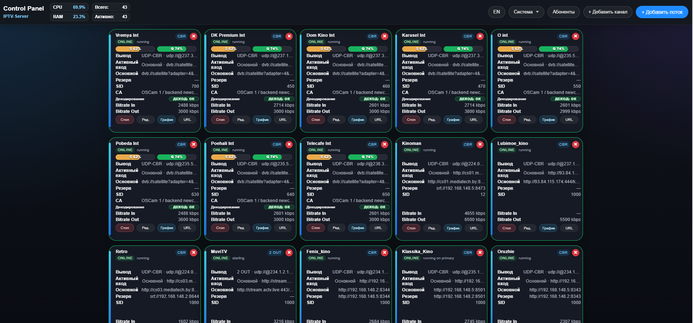
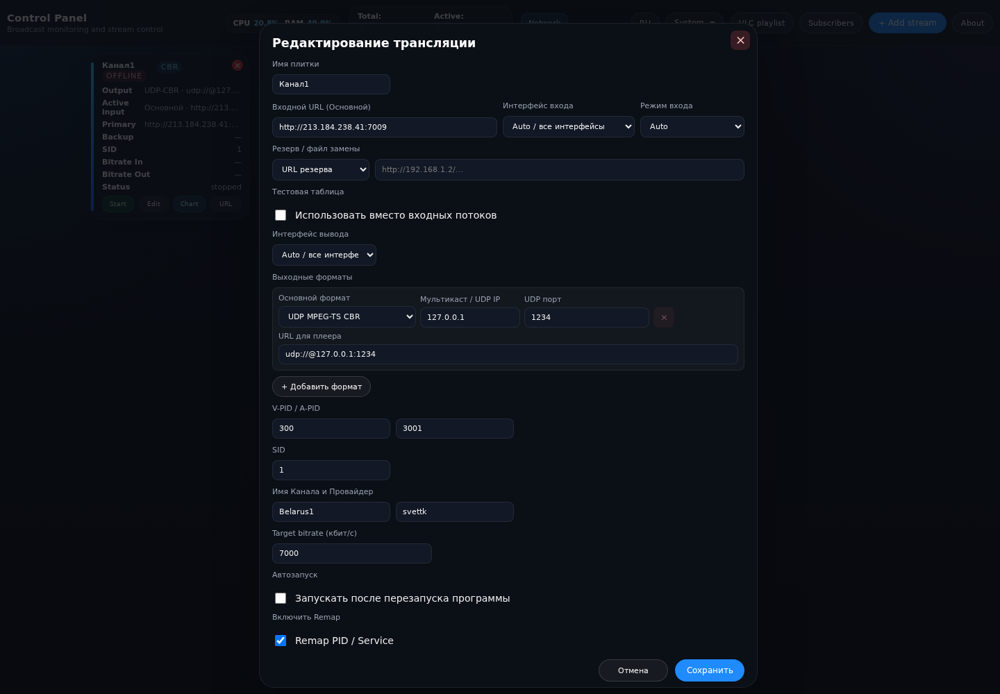
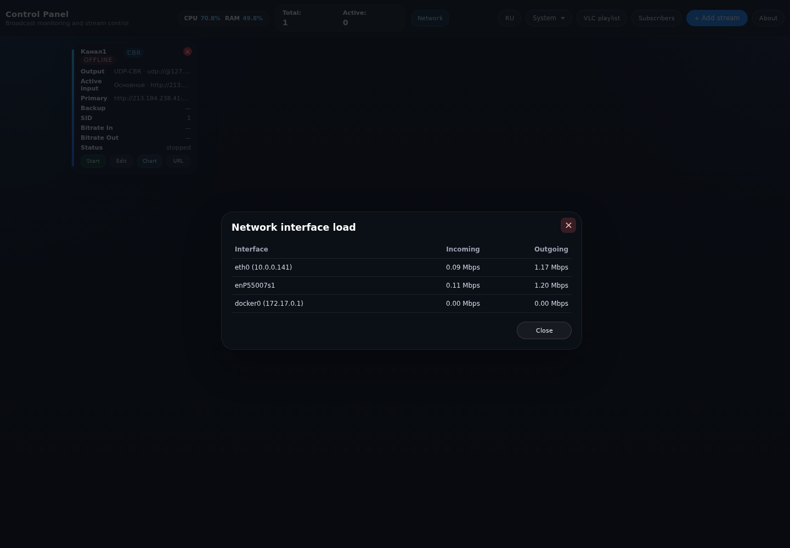
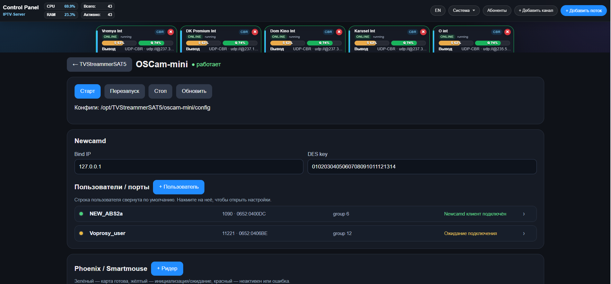

# DVBStreamer5

**Версия сервера:** [актуальная в AppVersion.h](src/AppVersion.h) · **Android Remote: 1.4** · **Linux x86_64** · **Русский / English**

**DVBStreamer5** — сервер приёма, обработки, маршрутизации и трансляции DVB-S/S2 и IPTV-потоков со встроенной веб-панелью, мониторингом, резервированием источников и нативным медиадвижком на C++.

[Сайт проекта](https://tvstreammersat5.tech/) · [Исходный код](https://github.com/Monkipnet/DVBStreamer5) · [Android APK](android-client/release/DVBStreamer5-Remote-1.4.apk) · [Инструкция Android](android-client/release/Инструкция.md)

> **Архитектура:** DVBStreamer5 не использует FFmpeg/libav или GStreamer как обязательный media framework. MPEG-TS, EPG, ремаппинг, выходные протоколы, CBR и ключевые этапы обработки реализованы в native media engine. Доступность аппаратного транскодирования зависит от оборудования, драйверов и параметров сборки.





## Возможности

- Добавление, редактирование, запуск, остановка и мониторинг каналов через Web UI.
- DVB-S/S2, DiSEqC, Unicable/JESS, MIS/Stream ID и совместное использование фронтенда сервисами одного транспондера.
- Основной и резервный IP-источник, переключение при потере сигнала и возврат после восстановления; локальный файл замены и циклическое воспроизведение в поддерживаемых конфигурациях.
- Входной и выходной MPEG-TS, переназначение SID/PID, PAT/PMT/SDT, CBR/VBR и контроль PCR.
- Нативное транскодирование и копирование аудио/видео; аппаратные NVIDIA NVENC/NVDEC, Intel QSV/oneVPL и VAAPI, где поддерживаются.
- HLS MPEG-TS и CMAF/fMP4, ABR/multibitrate, архив и timeshift.
- DVB EIT и внешние XMLTV-источники EPG с выбором каналов и выходной генерацией EIT.
- Опциональные DVB-субтитры, Conditional Access через плагины и OSCam-mini.
- Мониторинг битрейта, состояния потоков, абонентов, IP-фильтрации и уведомления Telegram.
- Интерфейс управления на русском и английском языках; отдельное Android-приложение.

## Архитектура

```text
DVB / UDP / RTP / HTTP / HLS / SRT / RTSP / RTMP / File
                         │
                  Native ingress
                         │
            MPEG-TS demux / remap / EPG
                  │               │
            Copy/passthrough   Native transcoder
                  │               │
                  └──────┬────────┘
                         │
             MPTS / CBR pacing / mux
                         │
         UDP / RTP / HTTP TS / SRT / HLS / RTSP / RTMP
```

Подробности: [NATIVE_MEDIA_ENGINE.md](NATIVE_MEDIA_ENGINE.md) и [OSCAM_MINI.md](OSCAM_MINI.md).

## Поддерживаемые протоколы

| Источник / протокол | Вход | Выход |
| --- | :---: | :---: |
| DVB-S/S2 | ✅ | — |
| UDP / RTP MPEG-TS | ✅ | ✅ |
| HTTP/HTTPS MPEG-TS | ✅ | ✅ |
| SRT (Caller/Listener) | ✅ | ✅ |
| HLS MPEG-TS, fMP4/CMAF | ✅ | ✅ |
| RTSP | ✅ | ✅ |
| RTMP/RTMPS | ✅ | ✅ |
| Локальный файл | ✅ | — |
| VDR / test pattern | ✅ | — |
| MPTS / ремаппинг сервисов | ✅ | ✅ |

Доступность конкретного режима зависит от версии и настроек канала.

## Веб-панель и мониторинг

По умолчанию панель доступна по адресу `http://SERVER_IP:9000/`. Начальные учётные данные типовой установки: `admin / admin`; **после первого запуска обязательно смените пароль**.

Панель отображает плитки потоков, активный источник, входной и выходной битрейт, состояние транскодирования и MPEG-TS, DVB-метрики, абонентов и диагностические события.





## DVB-S/S2 и Conditional Access

Поддерживаются Linux DVB frontend, DVB-S/S2 транспондеры, DiSEqC, LNB LOF, Unicable EN50494, JESS EN50607 и DVB-S2 MIS. Несколько каналов одного транспондера могут разделять один физический frontend. Для независимых транспондеров нужны отдельные тюнеры или соответствующая конфигурация оборудования.

CA-плагины и OSCam-mini предназначены только для оборудования, карт и сервисов, на использование которых у администратора есть законные права. Подробнее: [OSCAM_MINI.md](OSCAM_MINI.md).

## Системные требования

- Linux x86_64; для сборки и эксплуатации рекомендуются Ubuntu 22.04 / 24.04 либо совместимые дистрибутивы.
- Компилятор C++17, CMake, OpenSSL, libcurl, libxml2 и другие зависимости, устанавливаемые проектным скриптом.
- Для DVB-приёма — совместимые Linux DVB-устройства и доступ к `/dev/dvb`.
- Для аппаратного транскодирования — соответствующие GPU, драйверы и библиотеки; на сборочном сервере наличие GPU не обязательно.

## Сборка из исходников

Все команды выполняются **из корня исходного репозитория**, отдельный переход в каталог `build` не требуется:

```bash
git clone https://github.com/Monkipnet/DVBStreamer5.git
cd DVBStreamer5
git switch main
./install_deps.sh
cmake -S . -B build -DCMAKE_BUILD_TYPE=Release
cmake --build build --parallel 2
```

Проверка версии бинарника и исходников:

```bash
grep kProgramVersion src/AppVersion.h
test -x build/DVBStreamer5 && ls -lh build/DVBStreamer5
```

При необходимости проверка тестов:

```bash
cmake -S . -B build-tests -DCMAKE_BUILD_TYPE=Release \
  -DDVBSTREAMER5_BUILD_MEDIA_CORE_TESTS=ON \
  -DDVBSTREAMER5_BUILD_MP2_ENCODER_TESTS=ON
cmake --build build-tests --parallel 2
ctest --test-dir build-tests --output-on-failure
```

Сборка может требовать дополнительного времени и дискового пространства для закреплённых native codec sources. Инструкции: [INSTALL_LINUX_BUNDLE.md](INSTALL_LINUX_BUNDLE.md).

## Установка и systemd

Устанавливайте на тестовый сервер или в запланированное окно обслуживания. **Обычное сохранение настроек и обновление README не требуют перезапуска рабочих каналов.**

```bash
sudo mkdir -p /opt/DVBStreamer5 /etc/dvbstreamer5 /var/lib/dvbstreamer5/archive
sudo cmake --install build --prefix /opt/DVBStreamer5 --strip
sudo install -m 0644 packaging/dvbstreamer5.service \
  /etc/systemd/system/dvbstreamer5.service
sudo systemctl daemon-reload
sudo systemctl enable --now dvbstreamer5.service
systemctl status dvbstreamer5.service --no-pager
```

Рабочие конфигурации, абоненты, ключи интерфейса, файлы замены и архивы нужно резервировать до обновления. Не публикуйте их в GitHub.

## Обновление из Git

```bash
git switch main
git fetch origin
git pull --ff-only origin main
cmake -S . -B build -DCMAKE_BUILD_TYPE=Release
cmake --build build --parallel 2
ctest --test-dir build-tests --output-on-failure
```

`ctest` запускайте после настройки и сборки каталога `build-tests` по командам выше. Само обновление исходников и сборка **не перезапускают** production-сервис.

## Android Remote

Официальное приложение **DVBStreamer5 Remote 1.4** позволяет управлять DVBStreamer5 с телефона или планшета Android 8.0+. Интерфейс приложения поддерживает русский, английский и немецкий языки.

- [Скачать APK 1.4](android-client/release/DVBStreamer5-Remote-1.4.apk)
- [Каталог APK — архив предыдущих выпусков и новые версии в main](android-client/release/)
- [Инструкция](android-client/release/Инструкция.md)
- [Исходники Android-приложения](android-client/release/DVBStreamer5-Remote-1.4-source.zip)
- [SHA256SUMS](android-client/release/SHA256SUMS.txt)

Для получения самой новой версии проверяйте каталог `android-client/release` — номер APK может измениться независимо от версии сервера.

## Диагностика

```bash
systemctl status dvbstreamer5.service --no-pager
journalctl -u dvbstreamer5.service -f -o cat
./scripts/audit_runtime_deps.sh build/DVBStreamer5
nvidia-smi
vainfo --display drm --device /dev/dri/renderD128
```

GPU-команды применимы только на соответствующем оборудовании.

## Дополнительная документация и история изменений

- [NATIVE_MEDIA_ENGINE.md](NATIVE_MEDIA_ENGINE.md) — архитектура нативного движка.
- [INSTALL_LINUX_BUNDLE.md](INSTALL_LINUX_BUNDLE.md) — установка переносимого пакета.
- [OSCAM_MINI.md](OSCAM_MINI.md) — OSCam-mini и CA.
- [История изменений README в Git](https://github.com/Monkipnet/DVBStreamer5/commits/main/README.md) — подробные заметки по версиям, диагностике и экспериментальным исправлениям сохранены в истории Git.
- [Исходный репозиторий](https://github.com/Monkipnet/DVBStreamer5).

---

**DVBStreamer5** · © Monkipnet. Рекомендуется проверять новые сборки и аппаратные режимы на отдельном тестовом потоке перед развёртыванием.
